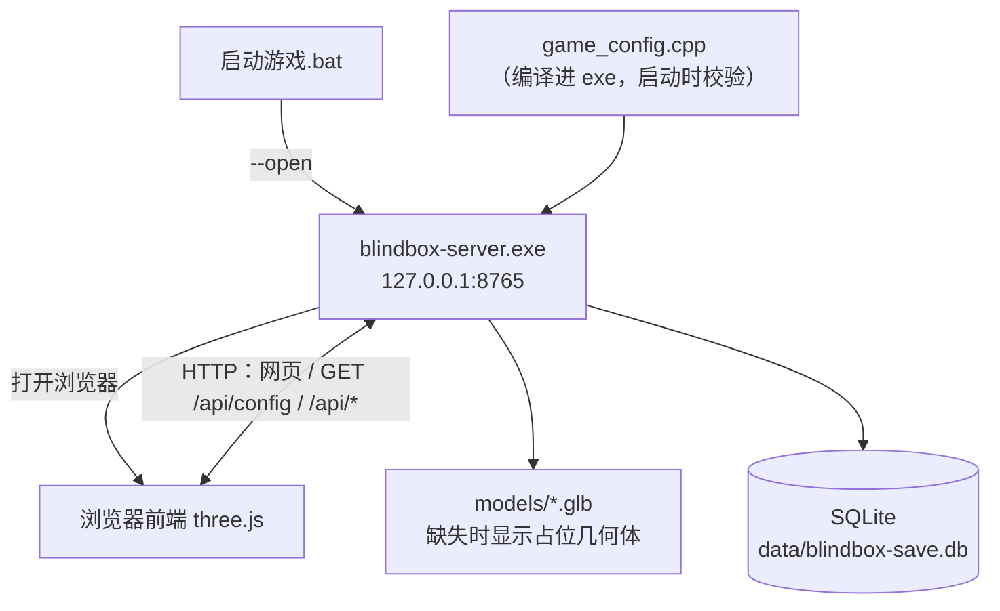

# Aholo 3D AI 黑客松 · 项目报告书（草稿）

> 项目名称：**开盲盒**（暂定）
> 提交截止：2026-11-19 19:00（北京时间）
> 本文档状态：草稿；规则与架构已按 v4 更新。文中部分截图仍是 v1/v2 界面，已标注「v4 界面待重截」。Lux3D 真模型截图与最终 Demo 链接待补

---

## 1. 项目概述

本作品是一款**单机网页盲盒收集游戏**：只通过本机 C++ 后端运行（同时提供网页、模型和全部游戏规则）。玩家花金币购买三种价位的盲盒，开出手办后放进展柜或卖掉换钱；**21 个手办全部放进展柜即通关**。三种盲盒开局就可买，没有解锁顺序，也没有集齐奖励。

全部 21 个手办的 3D 模型均由 **Aholo Lux3D 文生 3D** 预先生成，导出为 GLB 后打包进游戏。游戏运行时**不调用 Lux3D API、不消耗额度**；规则由本机后端执行。Lux3D 承担核心 3D 内容创作：没有这些模型就没有可玩的盲盒体验。

技术栈：three.js 前端 + 本机 C++17 后端（cpp-httplib / nlohmann/json / SQLite）。全部游戏内容配置在 `server/src/game_config.cpp`。双击 `启动游戏.bat` 启动 `blindbox-server.exe` 并打开浏览器；没有联机/单机切换，也不再使用 `items.json`。若直接用 `file://` 打开网页，会提示「请双击 启动游戏.bat 运行」。


*图：商店首页（三系列、金币与开盲盒入口）。几何体占位模型，v1 原型。**（v4 界面待重截：图中仍有锁定、统一盒价 100 与集齐奖励，v4 已改为三种盒子开局均可买，售价 100 / 200 / 400，无解锁与集齐奖励。）***


*三个系列集齐后的展柜全景（占位模型，第二版原型，用调试存档填满后截取）。**（v4 界面待重截：缺少顶部「收集进度 x/21」及各系列计数。）***

---

## 2. 玩法与核心循环

### 2.1 核心循环

```
花金币买任意一种盲盒（100 / 200 / 400）→ 开箱动画 → 展示界面
    → 选择：放进展柜 / 放入仓库 / 卖掉（点空白处 = 放入仓库）
    → 继续买盒；21 个手办全部在展柜里即通关
```

### 2.2 开箱与展示（v4）

1. 在商店点击任意一种盲盒，盒盖弹开，手办弹出。
2. 进入展示界面：手办居中，鼠标拖动可自由旋转；背景色按稀有度变化；显示名称与稀有度。
3. **新开出的**（或从仓库再次打开的）底部三个按钮：**[放进展柜]**、**[放入仓库]**、**[卖掉 +X 金币]**。点空白处 = 放入仓库。
4. 若展柜里已经有这一款，「放进展柜」按钮会变灰，并显示提示「展柜已有这款」（每款只能放一个）。
5. **展柜里的手办不能卖**。点击展柜中的手办会打开展示界面，但只有一个按钮：**[放入仓库]**；点空白处只是关闭。想卖掉，必须先放入仓库，再从仓库打开后卖掉。

开箱动画四帧（晃盒 → 打开 → 跳出 → 展示）：

| 晃盒 | 打开 | 跳出 | 展示 |
|:---:|:---:|:---:|:---:|
|  |  |  |  |

*图：开箱动画四帧。几何体占位模型，v2 原型。**（v4 界面待重截：图中商店仍有锁定与统一盒价；第 4 帧展示界面只有两个按钮，v4 应为三个。）***


*图：开箱后展示界面（拖动旋转）。几何体占位模型，v1 原型。**（v4 界面待重截：图中只有「放进展柜 / 卖掉」两个按钮，v4 新开出时应为三个，并含「放入仓库」。）***


*普通、稀有、史诗、隐藏款四种稀有度的展示背景对比（占位模型，第二版原型）。**（v4 界面待重截：按钮布局已改为三键 / 展柜单键。）***

### 2.3 界面结构（v4）

| 界面 | 内容 |
|------|------|
| 商店 | 三种盲盒全部可买，标价 100 / 200 / 400，以及当前金币 |
| 开箱 / 展示 | 见上；稀有度背景色；按来源显示三键或单键 |
| 仓库 | 未放进展柜或待出售的手办；点开后可放展柜或卖掉。刚开出时也可当场卖掉；展柜里的必须先放入仓库才能卖 |
| 展柜 | 按系列分行；未获得显示剪影；每格一款；顶部显示收集进度（总计 x/21，以及各系列 x/7） |

### 2.4 系列与通关

- 三个系列开局全部开放，可任意购买：**深夜食堂**（100 金币）、**打工动物**（200）、**怪奇家电**（400）。没有解锁顺序，也没有集齐金币奖励。
- 每个系列 7 个手办，一共 21 个。某系列在展柜里放满 7 个时，界面会标明该系列「已集齐」（只是进度提示，不发奖励）。
- **21 个手办全部放进展柜即通关**，保留通关画面（显示开盒数与用时），便于截图传播。通关只在第一次集齐时记录。


*图：旧版「系列集齐」弹窗（几何体占位模型，v2 原型）。**（v4 界面待重截：v4 已取消集齐奖励和解锁下一盒，此图不再代表当前规则。）***


*图：展柜（已获得手办与未获得剪影）。几何体占位模型，v1 原型。**（v4 界面待重截：图中仍有系列锁定，缺少顶部「收集进度 x/21」及各系列计数。）***


*图：全部集齐通关画面（显示开盒数与用时）。几何体占位模型，v2 原型。**（v4 界面待重截：背景商店仍是旧版锁定与统一盒价；通关条件现为 21 个全部在展柜。）***

---

## 3. 经济与稀有度

数值来源：`server/src/game_config.cpp`（唯一数据来源，带中文注释）。后端启动时校验配置，网页通过 `GET /api/config` 读取。

### 3.1 基础经济

| 项目 | 数值 |
|------|------|
| 开局金币 | 500 |
| 盲盒售价 | 深夜食堂 100、打工动物 200、怪奇家电 400 |
| 卖价倍率 | 与盒价同比：×1 / ×2 / ×4（写在 `game_config.cpp`，可改） |
| 单盒回本率 | 三种盒子都是 **98%**（见下表） |
| 破产补助 | 200。条件：买不起最便宜的盲盒（当前为 100），且仓库为空、没有展示中的手办。**展柜里的手办不能卖，因此不计入补助资格。** |

### 3.2 稀有度、掉率与卖价

实际卖价 = 稀有度基础卖价 × 该盲盒的卖价倍率。

| 稀有度 | 掉率 | 基础卖价 | 深夜食堂 ×1 | 打工动物 ×2 | 怪奇家电 ×4 | 背景色 |
|--------|------|----------|-------------|-------------|-------------|--------|
| 普通 | 60% | 30 | 30 | 60 | 120 | `#9aa0a6` |
| 稀有 | 25% | 80 | 80 | 160 | 320 | `#4a90e2` |
| 史诗 | 12% | 250 | 250 | 500 | 1000 | `#9b51e0` |
| 隐藏款 | 3% | 1000 | 1000 | 2000 | 4000 | `#f5a623` |

- 抽取规则：先按稀有度掉率（合计 60/25/12/3，启动时校验必须等于 1）抽稀有度，再在该盒同稀有度手办中按每个手办的权重 `weight` 加权抽取。权重在 `game_config.cpp` 里逐个配置，目前 21 个都是 1.0，即同稀有度内等概率；单个手办的基础概率 = 稀有度掉率 × 权重占比（例如每个普通款约 60% ÷ 3 = 20%）。
- 保底与防重复都**按系列分别计算**：同一种盲盒连续 12 个没出隐藏款，第 12 个必出该系列隐藏款；同一系列、同一稀有度里优先开出还没拥有过的，「已拥有」在开出时即计入，即便随后卖掉也算。
- 单盒期望卖价：深夜食堂 98、打工动物 196、怪奇家电 392，分别对应盒价 100 / 200 / 400，回本率都是 **98%**。没有集齐奖励，收入只来自卖掉手办和破产补助；光靠卖会慢慢亏。

展柜每款只能放一个；重复的只能放进仓库或卖掉。展柜中的手办不能直接卖，只能先放入仓库。

### 3.3 自动通关模拟（数值参考）

用后端 `blindbox-server --simulate 2000`（种子 20261110，每盒按 20 秒）各跑 2000 局，两种策略**全部通关**。结果如下（本稿撰写时复跑，与 `server/README.md` 一致）：

| 策略 | 开盒数 中位 / P90 | 折合时长（×20 秒）中位 / P90 | 破产补助次数 中位 / P90 |
|------|-------------------|------------------------------|-------------------------|
| 先买便宜的（深夜食堂 → 打工动物 → 怪奇家电） | **81 / 110** | 约 **27 / 37 分钟**（81×20÷60、110×20÷60） | 18 / 24 |
| 先买贵的（怪奇家电 → 打工动物 → 深夜食堂） | **68 / 96** | 约 **23 / 32 分钟**（68×20÷60、96×20÷60） | 22 / 27 |

补助次数的中位数约 18–22 次。这套数值**仍在讨论、待调**，本稿不宣称已达到某一目标时长。上述结果取代此前第二版的 41 / 58 盒统计。

### 3.4 手办清单（21 个）

**深夜食堂**（盒价 100，卖价 ×1，开局可买）

| id | 名称 | 稀有度 | 外观简述 |
|----|------|--------|----------|
| ms-01 | 打瞌睡的饭团 | 普通 | 三角饭团，海苔像被子，闭着眼睛 |
| ms-02 | 泡澡的拉面 | 普通 | 一碗拉面，溏心蛋泡在汤里像在泡澡 |
| ms-03 | 生气的辣椒 | 普通 | 红辣椒，眉毛竖起，头顶冒烟 |
| ms-04 | 举重的汉堡 | 稀有 | 汉堡长出手臂，举着薯条当杠铃 |
| ms-05 | 弹吉他的寿司 | 稀有 | 三文鱼寿司抱着一把小吉他 |
| ms-06 | 饺子武士 | 史诗 | 饺子戴武士头盔，拿筷子当刀 |
| ms-07 | 金色月饼王 | 隐藏款 | 金光闪闪的月饼，戴王冠披斗篷 |

**打工动物**（盒价 200，卖价 ×2，开局可买）

| id | 名称 | 稀有度 | 外观简述 |
|----|------|--------|----------|
| wa-01 | 送外卖的柯基 | 普通 | 柯基戴头盔，背外卖箱 |
| wa-02 | 收银的仓鼠 | 普通 | 仓鼠站在小收银台后面 |
| wa-03 | 加班的猫头鹰 | 普通 | 猫头鹰戴眼镜，对着笔记本电脑 |
| wa-04 | 咖啡师水獭 | 稀有 | 水獭系围裙，端着拿铁 |
| wa-05 | 消防员熊猫 | 稀有 | 熊猫穿消防服，拿水管 |
| wa-06 | 宇航员企鹅 | 史诗 | 企鹅穿宇航服，抱着头盔 |
| wa-07 | 董事长锦鲤 | 隐藏款 | 金色锦鲤穿西装，坐在老板椅上 |

**怪奇家电**（盒价 400，卖价 ×4，开局可买）

| id | 名称 | 稀有度 | 外观简述 |
|----|------|--------|----------|
| wd-01 | 害羞的电饭煲 | 普通 | 电饭煲脸红，盖子半开 |
| wd-02 | 跳舞的台灯 | 普通 | 台灯弯着脖子像在跳舞 |
| wd-03 | 打嗝的洗衣机 | 普通 | 洗衣机冒泡泡，门上有张嘴 |
| wd-04 | 冲浪的电风扇 | 稀有 | 小电风扇踩着冲浪板 |
| wd-05 | 唱歌的冰箱 | 稀有 | 冰箱门打开像张嘴唱歌，拿话筒 |
| wd-06 | 机甲吸尘器 | 史诗 | 吸尘器变形成小机甲 |
| wd-07 | 复古电视之神 | 隐藏款 | 老式显像管电视，长翅膀带光环 |

---

## 4. Lux3D 在项目中的使用

### 4.1 角色定位（对应评分「群核技术栈应用」30%）

规则要求 Lux3D 参与**核心 3D 内容或关键创作流程**。本项目中：

- 游戏内全部可收集手办（21 个 GLB）均来自 Lux3D 文生 3D；
- 运行时不调用 API，但创作流程以 Lux3D 为唯一建模来源；
- 报告以提示词、生成结果与迭代对比证明该流程。

### 4.2 统一生成设置

| 项 | 设置 |
|----|------|
| 模式 | 文字生成 3D（text-to-3d） |
| 试稿版本 | G1-Turbo |
| 定稿版本 | G1 |
| 面数 faceCount | 30000（隐藏款可 50000） |
| 输出格式 | glb，开启 PBR |
| 文件命名 | 手办 id，如 `ms-01.glb`，放入 exe 旁的 `models/` |
| 并发 | 免费账号上限 5；一次提交不超过 5 个任务 |
| 下载 | 链接约 2 小时过期，出完立即下载并按 id 改名 |

### 4.3 提示词设计：主体 + 统一风格尾巴

每个提示词 = **手办主体描述** + **统一风格后缀**，保证 21 个模型视觉一致（泡泡玛特式盲盒手办感）：

```
, cute chibi blind box vinyl toy figurine, Pop Mart style, smooth glossy plastic, soft pastel colors, big head small body, full body, single object, standing on a small round base, centered, no background
```

完整 21 条提示词见：`docs/lux3d-prompts.md`。

示例（ms-01 打瞌睡的饭团）：

> A sleepy triangular onigiri rice ball character with eyes closed, nori seaweed wrapped like a blanket, tiny Zzz bubble, cute chibi blind box vinyl toy figurine, Pop Mart style, smooth glossy plastic, soft pastel colors, big head small body, full body, single object, standing on a small round base, centered, no background

### 4.4 生成与迭代流程

1. 每个手办先用 **G1-Turbo** 出试稿，检查造型是否对题；不对则改提示词再跑。
2. 定稿后用 **G1** + 统一设置导出正式 GLB。
3. 每个模型留三类截图备报告：提示词界面、生成结果、（如有）改提示词前后对比；目录约定 `docs/screenshots/<id>/`。
4. 模型交给工程侧统一缩放与朝向后载入游戏。

**【截图占位:ms-01 提示词界面】**
**【截图占位:ms-01 生成结果】**
**【截图占位:ms-01 改提示词前后对比】**
**【截图占位:ms-07 隐藏款生成结果】**
**【截图占位:wa-07 隐藏款生成结果】**
**【截图占位:wd-07 隐藏款生成结果】**
**【截图占位:同系列普通 vs 史诗 风格一致性对比】**
**【截图占位:G1-Turbo 试稿 vs G1 定稿 对比（任选手办）】**

> 说明：上列截图待实际生成后填入，本稿不虚构结果。

---

## 5. 系统架构

以下内容按第四版（v4）实际代码与文档整理：`server/src/*.cpp`、`docs/api.md`、`server/README.md`、`启动游戏.bat`、`server/编译.bat`、`server/CMakeLists.txt`、`.vscode/tasks.json`。

游戏**只通过本机 C++ 后端运行**：没有联机/单机模式切换，也没有离线降级。双击 `启动游戏.bat` 启动 `blindbox-server.exe --open`，由它同时提供网页、`models/` 里的模型和全部游戏规则。找不到 exe 或启动失败时，启动器会报错并提示不要直接打开 html。若用 `file://` 打开页面，会显示「请双击 启动游戏.bat 运行」。运行时不调用 Lux3D API。没有二手市场或玩家交易，「卖掉」是按固定卖价卖给系统（且只能卖掉刚开出的或仓库里的手办）。

### 5.1 总体结构

后端 `blindbox-server` 是一个 C++17 程序（cpp-httplib v0.18.3、nlohmann/json v3.11.3、SQLite 3.47.2 amalgamation，依赖都在 `server/third_party/`），随游戏包分发。Windows 版为静态链接的 `blindbox-server.exe`，在 Linux 上用 Zig（clang + MinGW-w64）交叉编译。

同一进程默认监听 `http://127.0.0.1:8765`（端口被占用时依次往后试 9 个），同时负责：

- 提供网页和 `models/` 下的 GLB（因此不受 `file://` 加载限制）；
- 提供 `/api/*` 游戏接口：开盒（分系列的掉率、12 抽保底、防重复、权重）、展柜、仓库、卖给系统、破产补助、重置；
- 把存档写入 SQLite（默认 `data/blindbox-save.db`）。

全部规则都在服务器上计算，前端发来的只是「请求」。配置的唯一来源是编译进 exe 的 `server/src/game_config.cpp`，网页启动时通过 `GET /api/config` 读取。



### 5.2 配置：game_config.cpp

全部游戏内容都在 `server/src/game_config.cpp` 一个文件里，附中文注释：

- 盒子种类、盒价、卖价倍率（所有盒子开局就能买，顺序只影响商店排列）；
- 手办（id、中文名、稀有度、描述、权重、模型文件名，默认 `<id>.glb`）；
- 稀有度掉率、基础卖价、颜色；
- 保底次数与保底稀有度、防重复开关、开局金币、破产补助。

服务器启动时会校验配置，例如：掉率之和必须等于 1、id 不能重复、权重必须大于 0、盒价必须大于 0、每个掉率大于 0 的稀有度在每种盒子里都要有手办、模型文件名不能带路径。发现问题时会用中文列出全部错误，然后**拒绝启动**。`--check-config` 只做校验。可用 `--dump-config` 查看导出的 JSON，仅供检查，不是运行时配置文件。

### 5.3 模块划分（已实现）

| 模块 | 文件 | 职责 |
|------|------|------|
| 入口 | `main.cpp` | 命令行参数、校验配置、打开存档、启动 HTTP、`--open` 打开浏览器、生成 `models/README.txt`、`--simulate` 通关模拟 |
| 配置 | `game_config.cpp`、`config.h/.cpp` | 数值与内容；查询、校验、导出 JSON |
| 规则 | `economy.h/.cpp` | 开盒、分系列保底与防重复、加权抽取、卖出（仅展示中或仓库）、展柜与仓库互转、破产补助、21 个集齐通关 |
| 存档 | `store.h/.cpp` | SQLite，每个玩家一行，存档整体为 JSON；SQL 全部参数绑定 |
| 接口 | `routes.h/.cpp` | `/api/*`：读档 → 调规则 → 存档 → 回复；参数校验；全局锁保证同一时间只改一份存档 |
| 启动器 | `启动游戏.bat`、`启动游戏.command` | 启动本机服务器并打开浏览器；失败则报错，不降级到静态页 |
| 编译 | `server/编译.bat`、`build.sh`、`CMakeLists.txt`、`.vscode/tasks.json` | `编译.bat` 依次自动查找 g++、cl.exe、Visual Studio；VS Code 中按 Ctrl+Shift+B 调用它（Linux/macOS 调 `build.sh`）；CMake 可选 |

模型：Lux3D 生成的 `.glb` 放进 exe 旁边的 `models/`，文件名与配置一致；缺失的模型自动显示占位几何体。服务器每次启动都会重新生成 `models/README.txt`。

### 5.4 开箱与收集数据流（已实现）

1. 启动后，前端从本机后端读取 `GET /api/config`，再请求开箱等接口。
2. 玩家点击开盲盒，前端发送 `POST /api/open {seriesId}`。三种盒子开局均可买，服务器只检查：盒子存在、没有未处理的展示中手办、金币足够（不够且符合条件时先自动发 200 补助；仍不够则返回 `broke`）。扣钱前已保证余额足够，金币不会变成负数。
3. 抽取按**该系列**计数：连续 11 盒没出隐藏款则第 12 盒强制给隐藏款；否则按掉率抽稀有度。在该盒同稀有度中，先筛出该系列「从未拥有」的（开出即算拥有，卖掉也算），再按 `weight` 加权抽一个。
4. 结果写入 SQLite 并进入展示界面。新开出时三个按钮：
   - `POST /api/showcase` 放进展柜：若已有同款，按钮为灰色「展柜已有这款」，服务器也会拒绝（`already_in_showcase`）。全部 21 个都在展柜时通关。
   - `POST /api/storage` 放入仓库；点空白处同样走这条。
   - `POST /api/sell {from:"pending"}` 当场卖给系统。
5. 从仓库打开（`POST /api/reopen`）后，按钮与新开出时相同。从展柜点开则只能 `POST /api/unshowcase` 放入仓库；点空白处只关闭。卖掉只接受 `from: pending` 或 `from: storage`。

失败时返回 `{"ok": false, "error", "message": 中文说明}`，前端负责提示。

### 5.5 测试与验证状态

在 Linux 上实际运行，全部通过（本稿撰写时复跑）：

| 测试 | 来源 | 结果 | 覆盖要点 |
|------|------|------|----------|
| 接口测试 | `server/tests/api_test.py`（`npm run test:api`） | **50/50 通过** | 12 抽保底（按系列）、金币不为负、伪造或非法请求被拒、展柜不能卖、重复入柜被拒、补助不计展柜、重启后存档仍在 |
| 浏览器测试 | `tests/play.mjs` | **22/22 通过** | 三种盒价、三键展示、展柜仅「放入仓库」、收集进度 x/21 与分系列计数、空白处进仓库、刷新后存档保留、21 个通关、`file://` 显示启动器提示、页面中无「联网/单机」字样 |

**尚未验证（如实说明）**：`启动游戏.bat`、`server/编译.bat` 和 VS Code 编译任务都还没在真实 Windows 上运行过。Windows exe 是交叉编译的，同样没在 Windows 上实测。macOS 版（交叉编译、未签名）没在真实 Mac 上运行过。

---

## 6. 技术实现

### 6.1 总体架构

| 层 | 方案 |
|----|------|
| 渲染 | three.js，加载预生成 GLB（缺文件时用占位几何体） |
| 逻辑 / UI | 前端负责商店、开箱动画、仓库、展柜界面；规则与存档一律由本机 C++ 后端执行 |
| 数据 | `server/src/game_config.cpp` 为唯一配置，经 `GET /api/config` 下发 |
| 存档 | 后端写入 SQLite（`data/blindbox-save.db`） |
| 运行时网络 | 不请求 Lux3D API，无需公网服务器与 Key；只访问本机 localhost 上的游戏后端 |
| 分发 | 游戏 zip：网页、`models/`、`blindbox-server.exe`、`启动游戏.bat`。必须通过启动器运行 |

### 6.2 与 Lux3D 资产的衔接

- GLB 放进 `models/`，文件名与 `game_config.cpp` 中的 `model` 字段一致（默认 `<id>.glb`）；缺失时显示占位几何体，`models/README.txt` 自动列出缺哪些文件。
- 加载层预留统一缩放与朝向，吸收不同生成结果的尺寸差异。
- 面数控制在约 3 万（隐藏款可略高），保证 21 个模型同屏不卡。

### 6.3 开箱展示实现要点

- 点击盲盒 → 开箱动画 → 展示场景切换。
- 展示场景：OrbitControls（或等价）拖动旋转；背景色读取稀有度 `color`。
- 新开出：三键「放进展柜 / 放入仓库 / 卖掉」；点空白 → 仓库。展柜中点开只有「放入仓库」，不能直接卖。


*图：开发中原型——缺 GLB 时的占位几何体。v1 原型。**（v4 界面待重截：同 §2.2，按钮布局已过时。）***
**【截图占位:替换为真实 GLB 后的同界面】**

---

## 7. 与评分维度的对应

最终得分 = 专家评委 70% + 玩家评委 30%。维度与本项目对照如下：

| 维度 | 权重 | 本项目如何覆盖 |
|------|------|----------------|
| 群核技术栈应用 | 30% | Lux3D 文生 3D 产出全部 21 个核心手办；提示词规范 + G1-Turbo 试稿 / G1 定稿 + 迭代对比写入报告 |
| 作品有趣程度 | 25% | 盲盒开箱惊喜感；稀有度背景与旋转展示；三种价位盒子与「放展柜 vs 卖掉回血」的抉择；通关展柜可截图传播 |
| 创新性 | 20% | 把 Lux3D 资产做成可玩的概率收集经济，而非静态展厅；零运行时 API 仍让 Lux3D 占据创作核心 |
| 完成度 | 20% | 商店→开箱→展示→展柜/仓库→21 个集齐通关闭环；规则全部在本机后端；50 项接口测试与 22 项浏览器测试在 Linux 上通过；双击 `启动游戏.bat` 即玩 |
| 传播 | 5% | 计划发布小红书并带话题 **#Aholo黑客松**（帖子结果公布前保持公开） |

必交材料对照：

- **项目报告书**（PDF/PPT）：本文定稿后导出，含过程截图与资产迭代对比。
- **可运行 Demo**：链接或含真实运行画面的 Demo 视频。
- **加分**：小红书话题帖；源代码链接或压缩包（可选）。

---

## 8. 计划与时间线

| 节点 | 日期（北京时间） | 内容 |
|------|------------------|------|
| 选题与设计定稿 | 已完成 | 玩法与提示词表 |
| 第一版可玩原型 | 已完成 | 几何体占位；买盒、开箱动画、展示旋转、展柜与仓库 |
| C++ 后端 v4 | 已完成（Linux 测试通过） | 本机唯一运行方式；分价位盒子；无解锁/集齐奖励；展柜不可直接卖；50+22 项测试通过；Windows/Mac 实机待验证 |
| 真模型替换 + 报告截图 | **2026-11-17** | 21 个 Lux3D GLB 替换；按 v4 界面重截商店、展示、展柜与通关图 |
| 缓冲与打磨 | **2026-11-18** | 通关时长数值仍在讨论；性能、Demo 视频 |
| 提交截止 | **2026-11-19 19:00** | 报告 + Demo 链接/视频；可选小红书与源码 |

### 8.1 待办清单（报告侧）

- [ ] 按 `docs/lux3d-prompts.md` 完成 21 个模型生成，并按 id 归档截图到 `docs/screenshots/<id>/`
- [x] 填入 v1/v2 原型占位截图（商店 / 展示 / 展柜 / 开箱动画 / 系列集齐 / 通关；多数已与 v4 不符）
- [ ] 按 v4 界面重截商店、三键展示、展柜进度与通关等（已标注「v4 界面待重截」）
- [ ] 填入剩余 `【截图占位:…】`（Lux3D 生成结果、真模型替换对比）
- [ ] 写入最终可运行 Demo 链接或 Demo 视频链接
- [ ] 导出 PDF 或 PPT 作为正式报告书
- [ ] （加分）小红书 #Aholo黑客松 帖链接
- [ ] （加分）源码链接或压缩包

### 8.2 风险与应对

| 风险 | 应对 |
|------|------|
| 生成造型不稳定 | G1-Turbo 试稿 → 改提示词 → G1 定稿；统一风格尾巴 |
| 模型尺寸/朝向不一致 | 工程侧统一缩放与朝向 |
| 同屏卡顿 | faceCount 约 3 万；隐藏款可 5 万上限 |
| 纯卖转亏导致卡关 | 三种盒子回本率均为 98%，破产补助 200（展柜不计入可卖物）；数值仍在调整 |
| 隐藏款过稀 | 按系列 12 抽保底 + 同稀有度防重复 |
| 通关偏长 | 模拟中位约 23–27 分钟，数值仍在讨论 |
| Windows/Mac 启动或编译失败 | `.bat`、`编译.bat`、VS Code 任务和 Mac 版都需在真机上试跑；目前没有离线网页降级，必须通过启动器运行 |

---

## 附录 A · 关键文件路径

| 文件 | 说明 |
|------|------|
| `design.md` | 玩法与界面设计 |
| `server/src/game_config.cpp` | 全部游戏内容与数值（唯一数据来源） |
| `docs/api.md` | 后端接口文档 |
| `docs/lux3d-prompts.md` | 21 条 Lux3D 提示词与生成流程 |
| `docs/report-draft.md` | 本报告草稿 |
| `screens/` | v1/v2 原型界面截图（几何体占位；多数已与 v4 界面不符，待重截） |
| `docs/screenshots/<id>/` | （待建）各手办生成过程截图 |
| `models/<id>.glb` | （待生成）正式模型；`models/README.txt` 自动生成清单 |
| `server/` | C++ 后端源码、编译脚本、接口测试 |

## 附录 B · 提交信息占位

- 项目名称：开盲盒（正式名待定）
- Demo 链接：【待填】
- Demo 视频：【待填】
- 小红书 #Aholo黑客松：【待填】
- 源码：【待填】

---

*草稿结束。v4 界面重截、Lux3D 真模型截图与 Demo 补齐后导出为 PDF/PPT 提交。*
