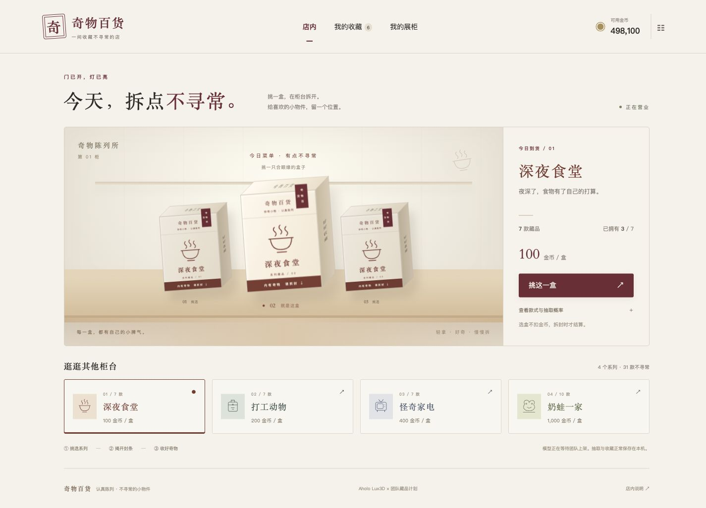
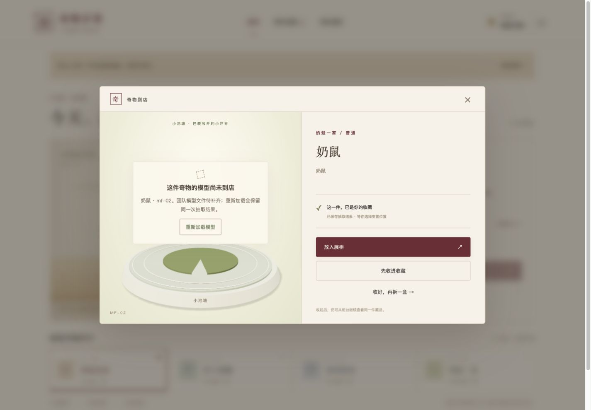
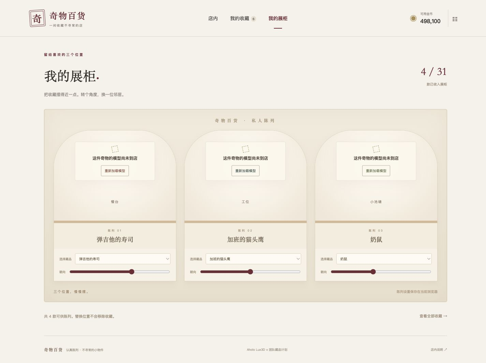
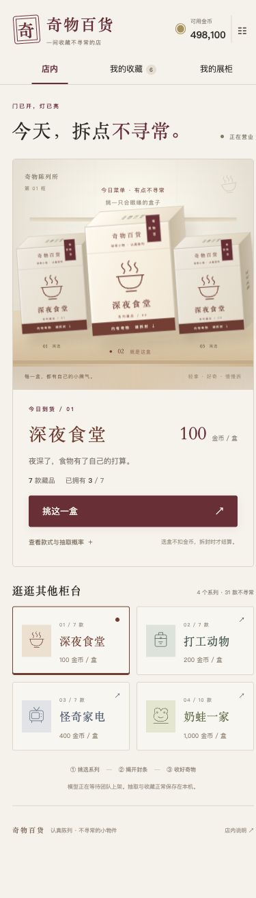

# 奇物百货第一版交付与验证记录

日期：2026-11-14（Asia/Shanghai）。交付范围为本地功能分支与可运行预览，没有发布线上站点。

## 工程基线

- 仓库为 `hyy898/blindbox`，开始时已处于 `feat/qiwu-storefront` 分支，工作区干净，起点为 `26b8c47`。
- 当前提交仅包含打包网页、C++ 本机服务程序、SQLite 存档和启动器，没有可直接开发的前端源码或依赖清单。历史提交 `1731f53` 的 `blindbox 3/` 留有较早的 Vanilla JavaScript、Three.js、Vite 与服务源码；其中规则和当前包体不同，未整体回退。
- 原版已通过隔离存档启动并在浏览器查看。原包缺失模型时会显示程序生成的几何占位，未明确标识资源缺失；第一版改为清楚的“模型待上架”和重试状态。
- 实际配置来自 `/api/config`：深夜食堂 7 款／100 金币、打工动物 7 款／200 金币、怪奇家电 7 款／400 金币、奶蛙一家 10 款／1000 金币，共 31 款。
- Git 工作树与历史中均没有实际模型；用户确认团队尚未上传。本轮没有生成或借用其他模型冒充奖品。

## 运行入口

本轮审阅预览使用 <http://127.0.0.1:8785/> 和独立测试存档；它依赖当前本机服务进程，停止后须重新启动。

正常启动方式：在仓库根目录执行 `npm ci`、`npm run build`、`npm start`，或在 macOS 打开 `启动奇物百货.command`。正常模式使用 `blindbox/data/blindbox-save.db`；隔离体验使用 `npm start -- --isolated`。实际地址以终端输出为准，详见 [README](../README.md)。

## 已实现

- **店铺与柜台：** 暖米白、酒红和少量暖木色；首屏直接挑选三个包装盒，四系列共用结构并切换包装图案和柜台主题。导航、余额、收藏数量和价格读取实际状态。
- **拆封：** 连续拖动封条反馈，同时提供按钮和键盘替代操作。选盒不扣费；确认拆封后先保存服务端结果，再播放约 4 秒的包装展开演出。支持跳过与减少动效。
- **揭晓：** 显示实际结果的名称、系列、稀有度和收藏状态。模型加载与演出独立，失败重试不再调用抽奖接口。关闭后通过柜台继续查看，刷新也保留原 pending 记录。
- **主题展台：** 四系列采用同一 CSS 2.5D 折翼过渡，并衔接 Three.js 小展台；分别使用餐台、工位、电器台与池塘意象。少量短音效由用户操作触发，默认静音。
- **收藏与展柜：** 保留原仓库、pending、展柜和售回规则。三个陈列位置读取真实展柜藏品，支持更换和朝向调整；位置变化不产生新库存。所有藏品仍可在“我的收藏”查看。
- **数据保护：** 本页写请求互斥；支持 Web Locks 的浏览器进行同源跨标签互斥。写入前核对最新存档，结果不明时只读取确认，不自动重发；待安置操作绑定具体实物身份，避免旧详情误处理另一件藏品。
- **运行与维护：** 新增可编辑前端、锁定依赖与标准构建入口；原服务二进制和 SQLite 保留。启动器运行服务文件的副本，不改变受版本管理的原文件权限。

## 实际验证

构建检查、接口检查和浏览器操作分别执行，彼此不替代。

| 验证层级 | 结果与证据 |
| --- | --- |
| 客户端逻辑 | 最终重跑 11 项 Node 测试全部通过，覆盖并发写入、pending 恢复、丢失响应后核对、未确认状态阻止写入及旧结果身份保护。 |
| 生产构建 | 最终 `npm run build` 通过。首屏 JavaScript 约 31 kB（压缩 12.4 kB）；按需加载的 3D 分包约 581 kB（压缩 149 kB），Vite 提示该分包体积较大，不影响构建通过。 |
| 真实服务 | 最终重跑 20 项隔离检查全部通过：12 个并发开盒请求只有一个成功，只有一次扣费及一条 pending；四系列价格和奖品身份正确；仓库／展柜转移不复制和不加收费用；重复款第二次入展柜被拒绝，仍能独立入库；重启后完整续档。 |
| 原数据保护 | 真实服务测试前后，原存档文件和服务二进制 SHA256 完全一致。测试使用临时数据库，从未调用原存档的重置操作。 |
| 拆盒操作 | 浏览器双击首盒开封按钮只扣 100 金币；实际拖动封条成功；跳过动画可进入结果；“收好，再拆一盒”回到拆封界面，不立即再次扣费。 |
| 结果一致性 | 深夜食堂实际结果 `ms-05` 在刷新和模型重试后仍一致，未再次扣费或重新抽取。关闭结果后可从柜台继续查看。 |
| 四系列实际开盒 | 深夜食堂三盒分别为 `ms-05`／`ms-01`／`ms-04`，每盒 100 金币；打工动物为 `wa-03`、200 金币；怪奇家电为 `wd-02`、400 金币；奶蛙一家为 `mf-02`、1000 金币。合计六盒支出 1900，测试余额为 498100。奶蛙用 Enter 开封，在演出中关闭后刷新，仍可继续同一结果。 |
| 收藏与陈列 | pending 入库、入展柜及仓库转展柜流程完成，余额不变。三席满位后第四款仍正常收入展柜，没有复制库存；第三席替换为 `mf-02` 奶鼠并调到 −30°，刷新恢复，第一席的 45° 朝向也保持。 |
| 偏好保存 | 声音与减少动效开启后刷新读取正确；验收结束已恢复静音、正常动效。 |
| 响应式 | 桌面 1440 × 1000 与手机 390 × 844 宽度下，导航、选盒和主要操作可见、可用。 |
| GLB 管线 | 独立临时测试 GLB 在浏览器成功解析，按钮、键盘及拖动旋转可用；404 后补文件重试成功，五轮创建／释放通过。此测试文件不作为产品藏品交付，也不代表实际 31 款模型验收。 |

可重复执行的命令：

```sh
npm test
npm run test:api
npm run build
```

## 审阅截图

以下截图来自隔离测试存档。结果与展柜中的“模型待上架”是实际缺失状态，不是完成实物展示的证明。

| 桌面柜台 | 结果与加载状态 |
| --- | --- |
|  |  |
| 三席展柜 | 手机柜台 |
|  |  |

## 限制与采用的简化

1. **31 个真实 GLB 均未到位。** 当前可验收真实规则下的抽取、收藏和陈列状态；真实藏品外观、逐款旋转效果和模型性能尚不能验收。页面明确提示缺失，不将系列图案或几何包装当成奖品。
2. 包装采用 CSS 2.5D 折翼与系列展台的自然过渡，没有实现真实纸盒的三维软体／折纸模拟。照片合影与“新邻居”动画未实施。
3. 金币、库存、pending 和原有展柜归属由 SQLite 保存；三个陈列位置、朝向和静音／动效偏好存于当前浏览器 `localStorage`。更换浏览器或来源端口不会丢失本机收藏，但不会自动带入陈列偏好。
4. 当前 GLB 管线未配置 Draco 或 KTX2 解码器，建议团队先提供纹理内嵌、未使用这些压缩扩展的 GLB。模型到位后仍须做逐款比例、纹理、灯光和移动设备性能验证。
5. 本轮实际运行环境为 macOS Apple Silicon。仓库中的 Intel macOS 与 Windows 服务保留，但未在对应系统实测；仓库未提供 Linux 服务程序。
6. 没有恢复旧后端源码替换现行程序，因此不能声称重新编译了后端。验收针对仓库中实际交付的二进制和 HTTP 行为。

## 主要改动文件

| 文件 | 内容 |
| --- | --- |
| `web/index.html` | 新店铺页面入口 |
| `web/src/main.js`、`style.css` | 页面、拆封和陈列交互，以及响应式视觉 |
| `web/src/themes.js` | 四系列主题配置与包装图案 |
| `web/src/api.js` | 保留原接口并增加请求保护与结果核对 |
| `web/src/viewer.js`、`viewer.css` | 真实 GLB 加载、旋转、展台和错误恢复 |
| `package.json`、`package-lock.json`、`vite.config.js` | 前端依赖、构建和开发代理 |
| `scripts/start.mjs`、`启动奇物百货.command` | 正常与隔离启动 |
| `blindbox/启动游戏.command` | 完整源码目录转新入口，保留原独立包逻辑 |
| `tests/api-client.test.mjs`、`tests/server-integration.py` | 针对状态一致性和原服务规则的检查 |
| `blindbox/dist/` | 项目正常启动使用的构建结果 |
| `assets/reference/original-team-hero.png` | 保留的原宣传图 |

分支：`feat/qiwu-storefront`。本轮仅在本地改造，没有自动发布或推送。
